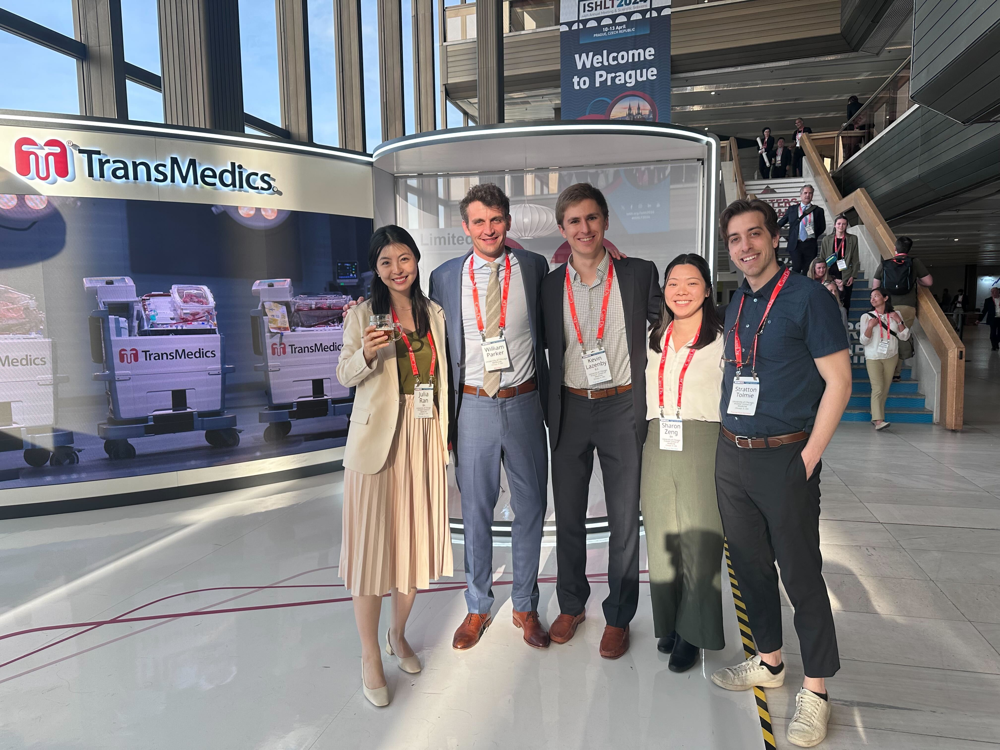

## Opportunities

Dr. Parker and the HCA lab welcome applications from interested students or post-doctoral fellows on a rolling basis. See our available roles and opportunities below.

## Post-doctoral fellowship programs

The HCA Lab seeks MD or PhD post-doctoral fellows with training in healthcare data science, health policy, health services research, critical care medicine, transplantation, or medical ethics. Formal training opportunities include:

### External post-doctoral fellowships

1. [The Siegler or Full-time Clinical Medical Ethics fellowships](https://grad.uchicago.edu/fellowship/maclean-center-for-clinical-medical-ethics-fellowships/)
2. Formal coursework in the [Public Health Sciences](https://health.uchicago.edu/) and throughout the University of Chicago as an at-large graduate student
3. [Pulmonary and Critical Care Medicine (PCCM) Fellowship](https://pccmfellowship.bsd.uchicago.edu/pccm-research-training/)

Direct T32 training grant funding is also available for qualified applicants. Fellows will be expected to apply for F or K level awards in the first year of their fellowship. Compensation in the Biological Sciences Division follows the NIH NRSA Stipend scale. Additional information on benefits and being a postdoc in the University of Chicago Biological Sciences Division can be found at [bsdpostdoc.uchicago.edu](https://bsdpostdoc.uchicago.edu).

### CLIF post-doctoral fellowship
We are seeking postdoctoral researchers to work on carrying out data science research studies for the Common Longitudinal ICU data Format ([CLIF](https://clif-icu.com/)) consortium. CLIF is a common data format for privacy-preserving federated critical care research developed by the CLIF consortium. The consortium is comprised of critical care clinicians and data scientists from 12 health systems who work collaboratively to execute a wide range of observational critical care electronic health record (EHR) studies, including Dr. William F. Parker’s R01 projects on crisis standards of care and organ allocation. However, CLIF post-doctoral fellows will be free to pursue any high impact question they are interested in using CLIF.

### Organ allocation post-doctoral fellowship
The HCA lab is seeking post-doctoral fellows with a specific focus on designing and evaluating organ allocation policy. Applicants from broad backgrounds (e.g. clinical transplantation fellows, health services research PhDs) are encouraged to apply. Data sources will include national transplant registries (SRTR and OPTN data) as well as emerging real-world EHR data sources.

To express interest, please email:

- **William F. Parker, MD, PhD** --- [william.parker@bsd.uchicago.edu](mailto:william.parker@bsd.uchicago.edu)
- **Haley Beck, MA** (Lab Manager) --- [haley.beck@bsd.uchicago.edu](mailto:haley.beck@bsd.uchicago.edu)

Include your CV, a brief description of your research interests, and any relevant experience.

## Graduate and Undergraduate Programs

Every year we welcome graduate and undergraduate students seeking experience in biostatistical research, particularly in the areas of organ allocation and intensive care medicine. Students in computational programs who are interested in programming data structures and algorithms with large sets of Electronic Health Record data (see [CLIF](https://clif-icu.com/)) are also encouraged to consider training in our lab. Students working in our lab will develop independent projects, conduct analyses of patient health data, create data visualizations, and co-author conference presentations and manuscripts, to the extent that their training program and experience level allows.

Dr. Parker is a participating research mentor in the programs listed below. Students in these formal programs will receive priority for our limited research rotation slots in the lab. Others who are not enrolled in a formal program may apply via our [application](https://docs.google.com/forms/d/e/1FAIpQLScKoJ2OD2Zmgb1EOzjzpmWUDbMLcwg7XAmuQfOTaiBxD3U1wg/viewform). For those applying independently, (i.e., without program enrollment), compensation at the rate of minimum wage for up to 20 hours/week may be available depending on grant funds. Compensation for students enrolled in formal programs will vary.

For undergraduate programs and independent students who are new to the lab, research rotations will begin in the Summer Quarter. The summer program schedule is typically from early June to late August. The lab will follow a similar schedule for independent students.

### PhD Student Research Rotation

1. [Department of Public Health Sciences PhD Program](https://biosciences.uchicago.edu/programs/public-health-sciences)

### Medical Student Research Rotation

1. [Pritzker Summer Research Program (SRP)](https://pritzker.uchicago.edu/scholarly-opportunities/summer-research-program)
2. [Pritzker Scholarship and Discovery (S&D)](https://scholarshipdiscovery.uchicago.edu/)

### Undergraduate Student Research Rotation

1. [Biological Sciences Collegiate Division (BSCD) Summer Fellowship](https://college.uchicago.edu/academics/biological-sciences-collegiate-division-summer-fellowship)
2. [Pritzker School of Medicine Experience in Research (PSOMER)](https://pritzker.uchicago.edu/resources/summer-pathway-programs)

### What You'll Do In the HCA Lab

- Analyze large-scale patient health datasets using R or similar tools
- Create data visualizations for research findings
- Co-author and potentially first-author conference presentations and manuscripts
- Contribute to ongoing research in organ allocation, crisis standards of care, or scarce therapeutics

### Lab Requirements

- Basic statistics knowledge preferred
- Experience with data analysis software (R or similar) preferred
- For independent students - minimum four week commitment during the Summer Quarter for 20 hours per week

### Apply

To apply for an independent graduate or undergraduate research rotation in the lab, please complete our application form by **April 1st at 11:59 pm CT**, preceding the Summer Quarter in which you intend to work in the lab.

<a href="https://docs.google.com/forms/d/e/1FAIpQLScKoJ2OD2Zmgb1EOzjzpmWUDbMLcwg7XAmuQfOTaiBxD3U1wg/viewform" class="apply-btn" target="_blank" rel="noopener">Open the application form &rarr;</a>

**In addition, please email your CV/résumé and academic transcript (unofficial is ok) to both:**

- **Haley Beck, MA** (Lab Manager) --- [haley.beck@bsd.uchicago.edu](mailto:haley.beck@bsd.uchicago.edu)
- **William F. Parker, MD, PhD** --- [william.parker@bsd.uchicago.edu](mailto:william.parker@bsd.uchicago.edu)

## Why Join

As a prolific researcher and recipient of many training and research grants working at one of the top US and global research universities, Dr. Will Parker is equipped to provide excellent mentorship to post-doctoral fellows who are seeking to launch their careers as independent scholars of medicine and public health. Dr. Parker is well-versed in the process of applying for tenure-track faculty positions and establishing a lab, and frequently leads workshops and training sessions on preparing competitive NIH grant proposals, particularly training, fellowship, and career development awards. He is also fortunate to be connected to a broad, interdisciplinary network of researchers and clinicians who can help get post-docs plugged into their desired field. Many of Dr. Parker's post-doctoral trainees have gone on to be successful physician-researchers with tenure-track positions, and he continues to collaborate with them.

Additionally, the lab has a strong track record of preparing graduate and undergraduate trainees for success in competitive residency, PhD, and vocational programs. Dr. Parker has supported many graduate students in publishing their first (and additional) first-authored manuscripts in leading journals. Successful graduate students in the lab develop advanced biostatistics skills, gain experience with real-world transplant and critical care datasets, and strengthen their academic portfolios. Undergraduates gain valuable experience in data science and have opportunities to contribute in co-author roles to manuscripts submitted for publication. They will be introduced to the skills and experiences that are desired in prospective graduate students, and often have opportunities to add conference presentations to their resume/CV.

